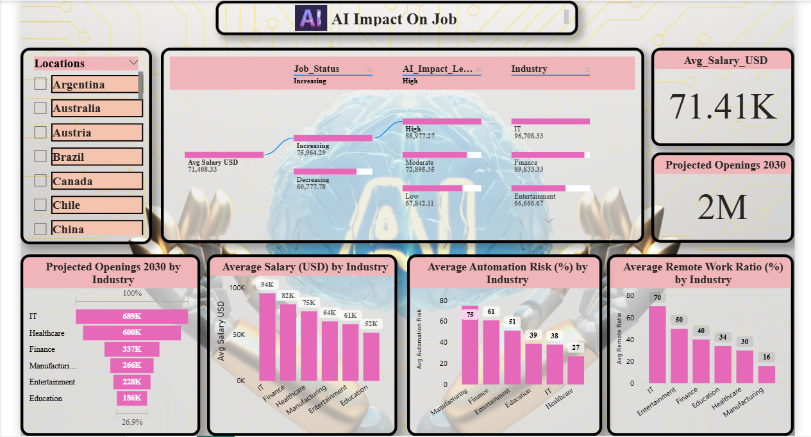
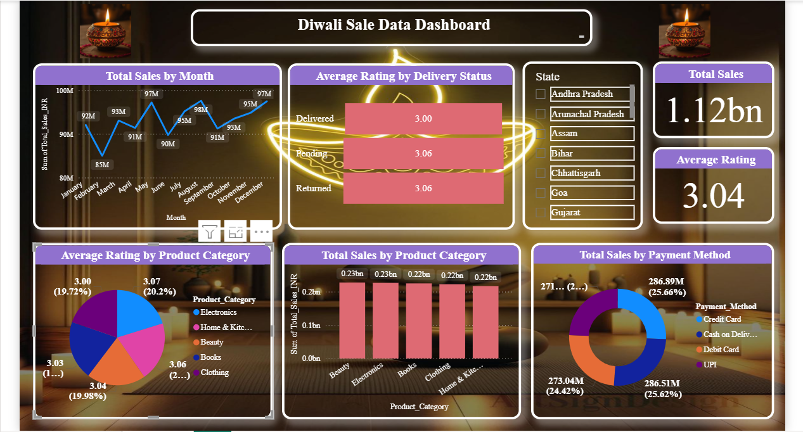
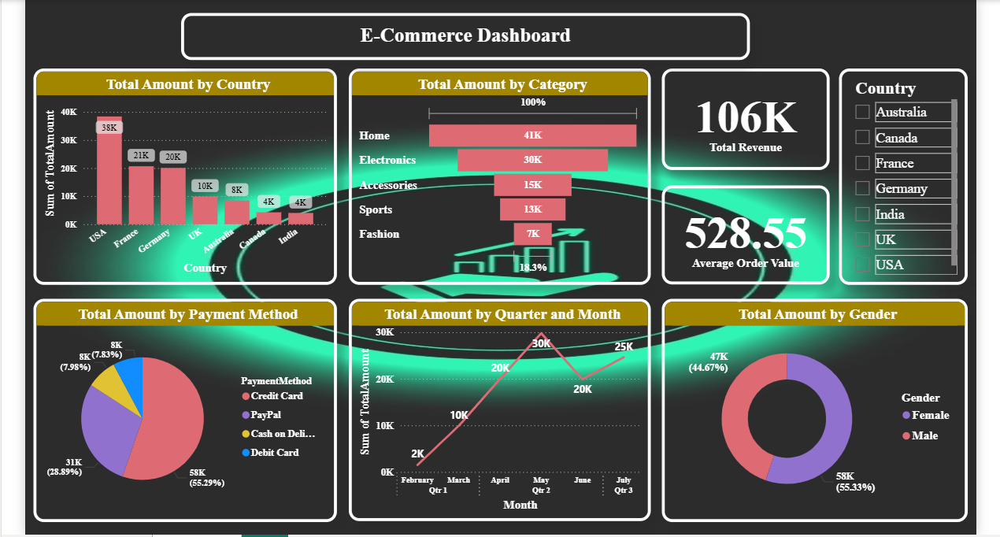
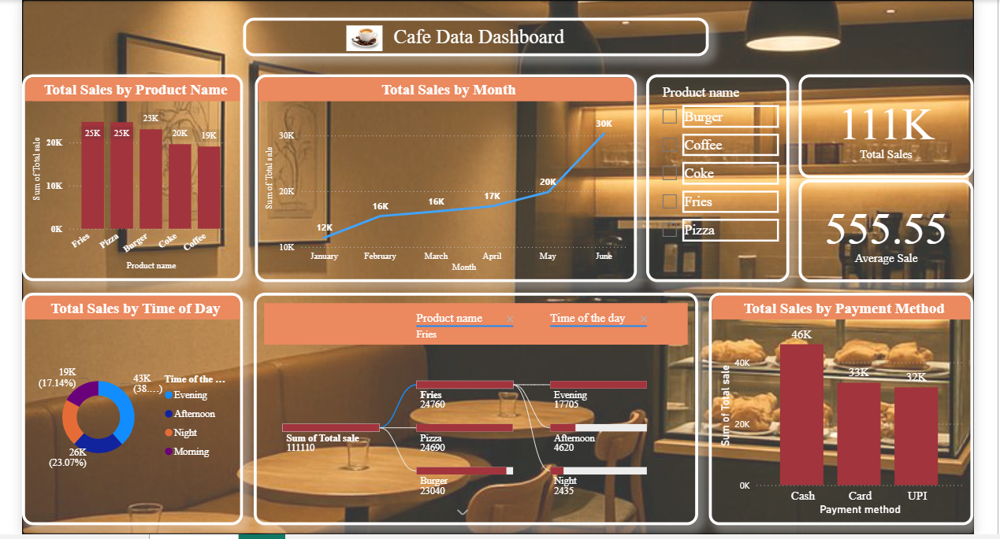
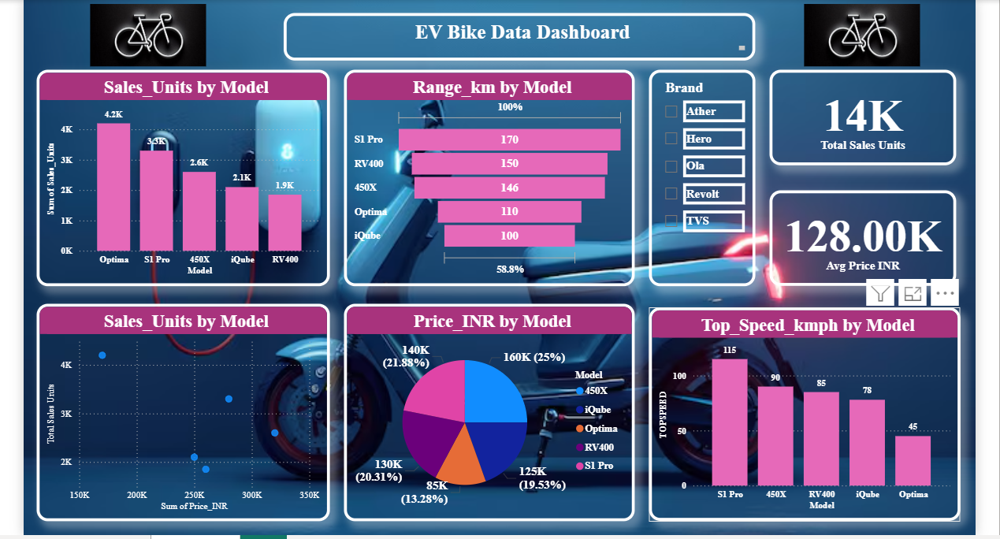

# Power BI Dashboards

Five end-to-end Power BI dashboard projects covering data cleaning, data modeling, KPI design and business insights. Each project has its Power BI report (`.pbix`) and, where available, its source data.

**Tools:** Power BI Desktop, DAX, Excel, SQL

| # | Project | Domain | Data size | Report file |
|---|---------|--------|-----------|-------------|
| 1 | AI Impact on Jobs | Labour market | 120 records, 6 industries | `AI_Impact_On_Job.pbix` |
| 2 | Diwali Sales Dashboard | Retail / E-commerce | 15,000 orders, 28 states | `Diwali_Data_Dashboard.pbix` |
| 3 | E-Commerce Sales Dashboard | E-commerce | 200 orders, 150 customers | `E_Commerce_Dashboard.pbix` |
| 4 | Cafe Dashboard | Food & Beverage | 200 orders (Jan-Jun 2025) | `Cafe_Dashboard.pbix` |
| 5 | EV Bike Data Dashboard | Automotive | 5 brands, 5 models, 14K units | `EV_Bike_Data_Dashboard.pbix` |

---

## 1. AI Impact on Jobs

**Data:** `AIjobimpact.xlsx` | 120 records, 6 industries, 39 locations

**Business question:** Which industries are most exposed to automation, and where are jobs growing?

**Key findings**
- **Manufacturing** has the highest average automation risk (75%) and is the only industry with a projected decline in job openings (-12% by 2030).
- **IT** shows the strongest growth (+59% openings by 2030), the highest remote-work ratio (70%) and the highest average salary ($94K).
- Healthcare has the lowest automation risk (27%).
- Total openings across all industries are projected to grow from 1.85M (2024) to 2.30M (2030), about +24%.

**Dashboard:** average salary and projected-openings cards, decomposition tree (job status, AI impact level, industry), average salary, automation risk and remote-work ratio by industry, projected openings funnel, location slicer.

---

## 2. Diwali Sales Dashboard

**Data:** `Diwali_Dashboard_2.csv` | 15,000 orders, 7,259 customers, 28 states (2025)

**Business question:** How do sales vary across product categories, payment methods and delivery outcomes?

**Key findings**
- Total revenue of ₹111.8 Cr with an average order value of ₹74.5K.
- Revenue is spread almost evenly across the 5 categories (Beauty, Electronics, Books, Clothing, Home & Kitchen), each about 19-20%.
- 32.5% of orders are "Returned" and 33.6% are "Pending", an unusually high share that would need investigation in a real business.
- Average rating is 3.04 and almost identical across delivery statuses and categories.

**Dashboard:** total sales and average rating cards, sales by month, average rating by delivery status and by category, sales by category, payment-method donut, state slicer.

---

## 3. E-Commerce Sales Dashboard

**Data:** `ECommerce_dataset.xlsx` | 200 orders, 150 customers, 7 countries

**Business question:** Which categories, countries and customers generate the most revenue, and how healthy is order fulfilment?

**Key findings**
- Total revenue of 105.7K, average order value 528.55.
- **Home** (38.5%) and **Electronics** (27.9%) generate about 66% of revenue.
- **USA** is the top market with 36% of revenue; Credit Card is the most used payment method (55%).
- 85% of orders are delivered; only 1.6% are returned or cancelled; 98% of reviews are positive.

**Dashboard:** total revenue and average order value cards, total amount by country, category funnel, payment-method pie, monthly trend, gender donut, country slicer.

---

## 4. Cafe Dashboard

**Data:** `Cafesales.xlsx` | 200 orders, Jan-Jun 2025

**Business question:** Which products and times of day drive the most sales?

**Key findings**
- Total revenue of ₹1.11 lakh, average order value ₹555.55.
- **Evening** is the peak period with 38.6% of revenue (about ₹43K); Morning is the lowest at 17.1%.
- Fries, Pizza and Burger together contribute about 65% of revenue.
- Monthly revenue grew from ₹12K (Jan) to ₹30K (Jun), about 2.6x.
- Cash is the most used payment method (41%).

**Dashboard:** total sales and average sale cards, sales by product, sales by month, time-of-day donut, decomposition tree (product, time of day), payment-method chart, product slicer. Page 2 contains the written insights and recommendations.

---

## 5. EV Bike Data Dashboard

**Data:** 5 brands, 5 models | 14K total units sold

**Business question:** How do electric bike models compare on sales, price, range and top speed?

**Key findings**
- **Optima** (Hero, ₹85K) is the best seller with 4.2K units (about 30% of 14K), followed by **S1 Pro** (Ola, 3.3K units). Hero and Ola together account for about 53% of units.
- **S1 Pro** has the longest range (170 km) and the highest top speed (115 kmph), at a mid-high price of ₹140K.
- **Optima** is the cheapest (₹85K) but has the lowest top speed (45 kmph) and a modest range (110 km).
- **450X** (Ather) is the most expensive (₹160K) and still sells 2.6K units.
- **iQube** (₹125K, 2.1K units) and **RV400** (₹130K, 1.9K units) are the lowest sellers.
- Price alone does not decide sales: the cheapest model leads, but the S1 Pro outsells cheaper models like iQube and RV400.

**Dashboard:** total sales units and average price cards, sales units by model and by brand, price vs sales units scatter chart, range, price and top speed by model, brand slicer.

---

## How to open
1. Install [Power BI Desktop](https://powerbi.microsoft.com/desktop/) (free, Windows).
2. Download the `.pbix` file of the project you want to explore.
3. Open it in Power BI Desktop and use the slicers to filter the data.

## About me
**Shivtej Chougule**, aspiring Data Analyst (SQL, Excel, Power BI, Python).
[LinkedIn](https://www.linkedin.com/in/shivtej-chougule-723360414) | shivtejchougule16@gmail.com | [Python Projects](https://github.com/shivtejchougule16/PythonDataAnalysis)
